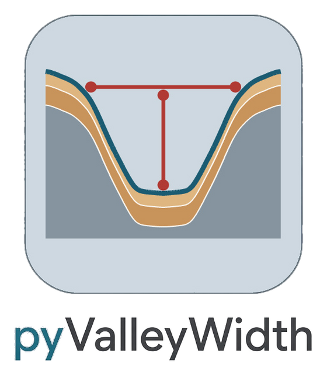
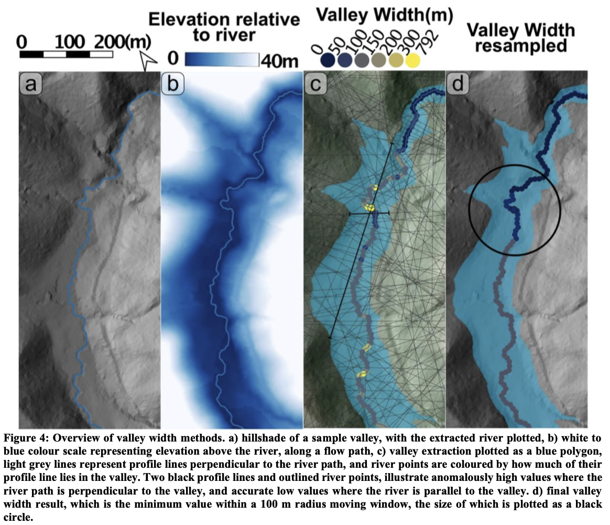
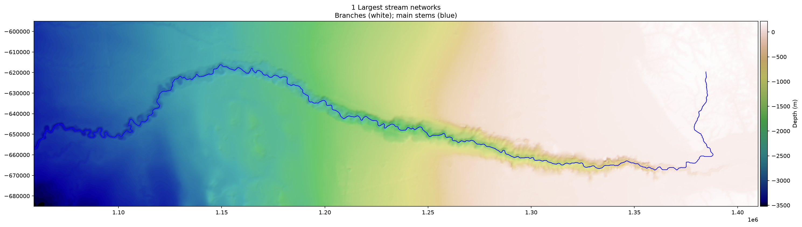
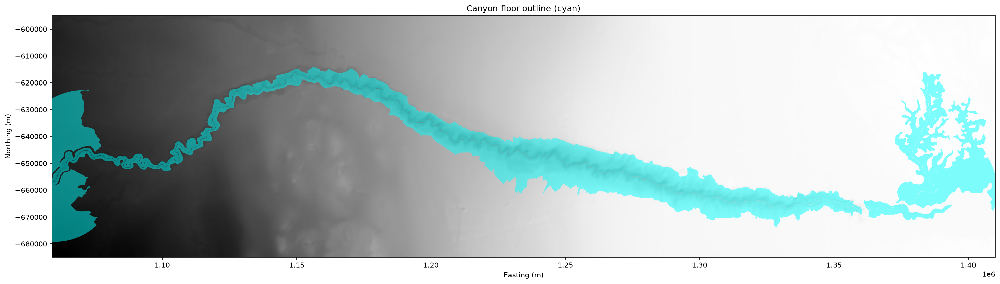
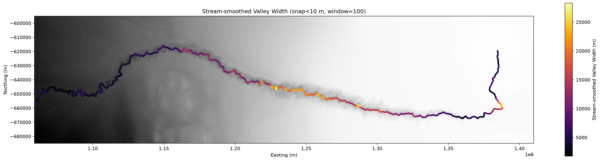
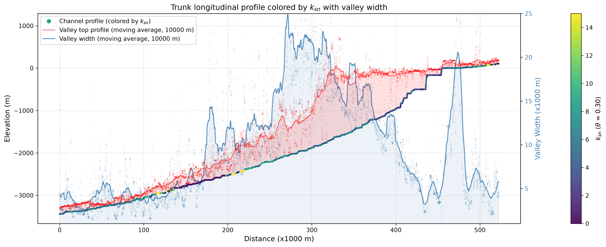
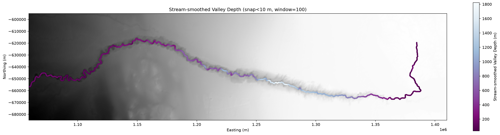

<p align="center"></p>

# pyValleyWidth

[](https://pypi.org/project/pyvalleywidth/) [](https://pepy.tech/project/pyvalleywidth) [](https://doi.org/10.5281/zenodo.23656980) [](./LICENSE)

Python tools to measure **valley width** from a digital terrain model (DTM) or bathymetry grid, built on **[pytopotoolbox](https://github.com/TopoToolbox/pytopotoolbox)**.

> [!WARNING]
> **pyValleyWidth** is under active development and has not yet been peer-reviewed or fully validated. Please use with caution.

## Overview

pyValleyWidth was originally made to measure the widths of mountain river valleys. In the Congo Canyon example, we adapt a revised version of the method to the seafloor: at each cross-section the tool finds where the canyon "spills over" its rims, so the canyon edge can sit at a different height along the channel instead of one fixed value. Combined with channel-steepness and long-profile tools, this gives a quick way to measure submarine canyon widths and to see how a canyon's width, depth and steepness change downstream, a window into the long-channel profile morphodynamics of submarine canyons.

## How it works

1. **Find the channel.** Water (or sediment) flow is routed over the grid and the main channel is traced.
2. **Cut cross-sections.** Lines are drawn across the channel at regular spacing and trimmed to the ridges on each side.
3. **Find the rim.** On each cross-section an imaginary water level is raised step by step. The width grows slowly, then jumps when the water spills over the valley or canyon rim. That jump marks the edge.
4. **Measure and smooth.** Widths and depths are read off at every cross-section and smoothed along the channel to give clean maps and downstream profiles.

The classic mode (`max_valley_width=False`) uses one fixed height above the channel everywhere; the revised mode (`max_valley_width=True`) finds the rim separately at each cross-section as in step 3.



*Method overview after Morgan et al. (2026).*

## Example: Congo Canyon

The notebook [`pyValleyWidth_1_CongoCanyon.ipynb`](./pyValleyWidth_1_CongoCanyon.ipynb) [](https://colab.research.google.com/github/GeoLarryLai/pyValleyWidth/blob/main/pyValleyWidth_1_CongoCanyon.ipynb) runs the revised mode on a 60 m bathymetry grid of the Congo Canyon, offshore West Africa.



*The bathymetry grid with the traced main canyon channel.*



*The canyon floor outlined from the rim found at every cross-section.*



*Canyon width measured along the channel, smoothed downstream.*



*Downstream long profile: the channel colored by steepness, with canyon width (blue) and canyon-top depth (red), distance is measured upstream from the deep-sea end of the traced channel.*



*Canyon depth (rim height above the channel floor) along the channel.*

A second notebook, [`valley_width_example.ipynb`](./valley_width_example.ipynb), shows both modes on the Big Tujunga mountain DEM bundled with topotoolbox.

## Installation

```bash
pip install pyvalleywidth
```

This also installs `topotoolbox`. Or, from a clone of this repository: `pip install -e .`, or create the conda environment with `conda env create -f environment.yml`.

## Quick start

```python
import topotoolbox as topo
import pyValleyWidth as pyvw

dem = topo.read_tif("example_data/CongoCanyon/CongoCanyon_bathymetry_smoothed.tif")
allwidths, DV, allvalleydepth = pyvw.dem2widths(
    dem, streamarea=5000, swath_dx=50, minradius=30000,
    max_valley_width=True, min_dwdt=10, max_dwdt=100,
)
```

The notebooks explain every parameter. See [FUNCTION_DOCUMENTATION.md](./FUNCTION_DOCUMENTATION.md) for the full function list.

## Repository contents

| Item | Purpose |
|------|---------|
| `pyValleyWidth/` | The package |
| `pyValleyWidth_1_CongoCanyon.ipynb` | Submarine canyon example (revised mode) |
| `valley_width_example.ipynb` | Mountain valley example (both modes) |
| `example_data/CongoCanyon/` | Example bathymetry grid |
| `figures/` | Figures produced by the Congo Canyon notebook |
| `FUNCTION_DOCUMENTATION.md` | Function reference |
| `environment.yml` | Conda environment |

## Data credit

The Congo Canyon grid in `example_data/` is derived from public bathymetry data (cropped, resampled to 60 m, gap-filled and smoothed).

Source: derived from the Ifremer Congo (Zaire) deep-sea fan multibeam bathymetry compilation (WGS84 / Mercator 5°30'S), compiled from the ZAIANGO 1 & 2, ZAIANGOCAR, ZAIANGO-OBS-BIOL, REPREZAI Leg 1, WACS and CONGOLOBE cruises. Cropped, resampled to 60 m and smoothed for this example.

Ifremer, Géosciences Marines (2019). Bathymétrie - Zaire (ZAIANGO 1 et 2, ZAIANGOCAR, ZAIANGO_OBS_BIOL, REPREZAI LEG1, WACS, CONGOLOBE). Ifremer. https://doi.org/10.12770/d1076601-82a9-42a2-9d30-d0be8b2481a7

## Citation

If you use **pyValleyWidth** in your work, please cite:

Lai, L.S.-H. (2026) pyValleyWidth. *Zenodo*, [https://doi.org/10.5281/zenodo.23656980](https://doi.org/10.5281/zenodo.23656980)

pyValleyWidth is inspired by Paul Morgan's **[ElevationThresholdValleyWidth](https://github.com/PMonroeMorgan/ElevationThresholdValleyWidth)** MATLAB workflow. If you use the threshold-based method, please also cite:

Morgan, P. M., Grant, A., Struble, W., LaHusen, S., and Duvall, A. (2026) The damability function: a probabilistic approach to regional landslide dam susceptibility analysis applied to the Oregon Coast Range, USA. *Nat. Hazards Earth Syst. Sci.*, 26, 1745–1766, https://doi.org/10.5194/nhess-26-1745-2026

Please also cite **[pytopotoolbox](https://github.com/TopoToolbox/pytopotoolbox)**:

William Kearney, Boris Gailleton, Theophil Bringezu, ginaarnau, Luca Malatesta, François Faure, & Xiaochuan Ye. (2026). TopoToolbox/pytopotoolbox [Computer software]. Zenodo. https://doi.org/10.5281/zenodo.16742408

pyValleyWidth's dependency pytopotoolbox is released under the GNU GPL.
